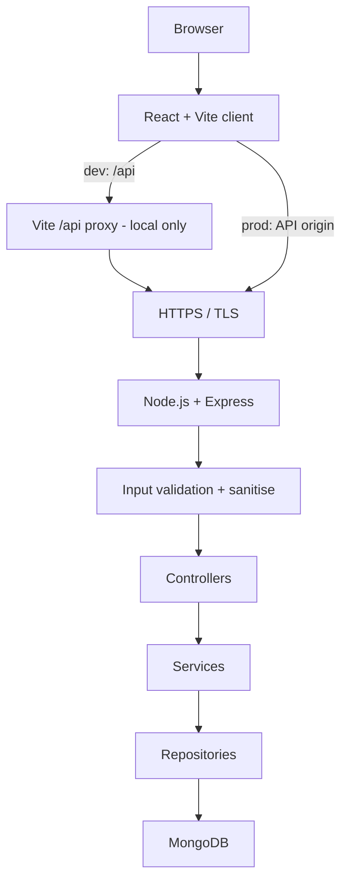
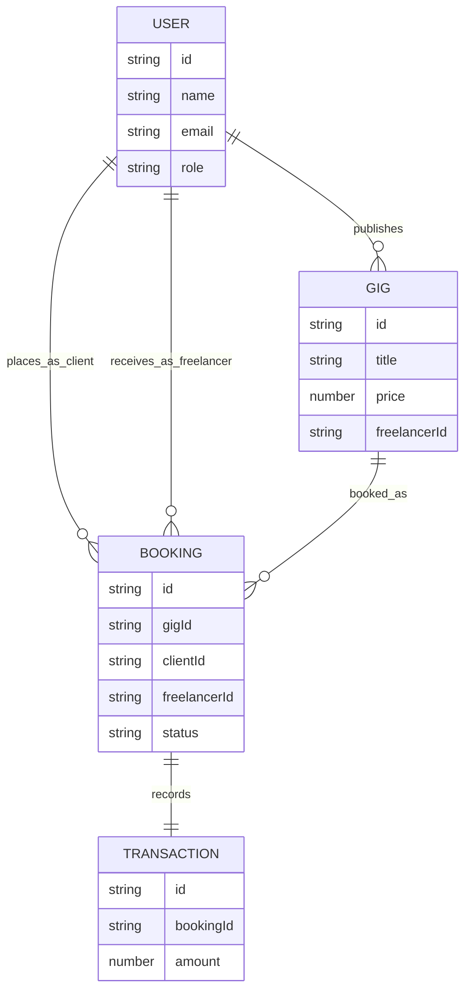
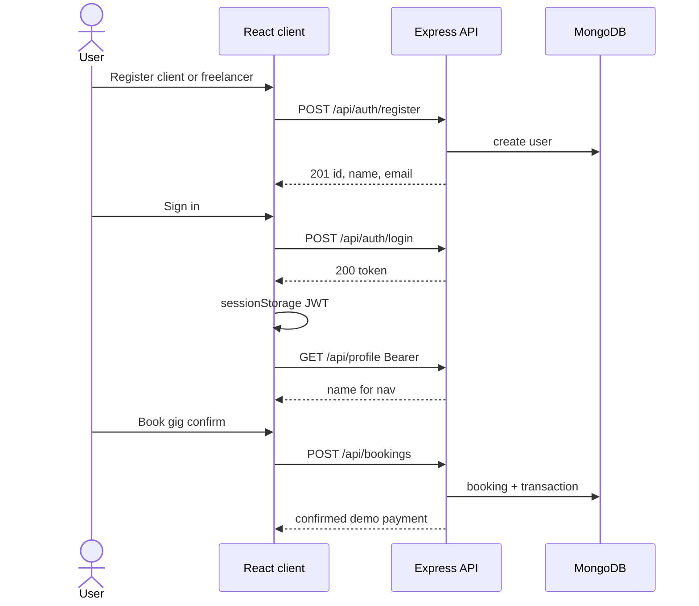
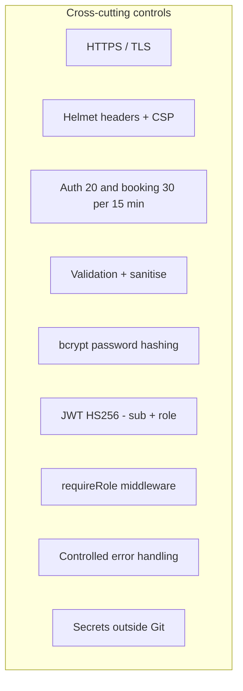

# HustleHub+

HustleHub+ is a secure freelance marketplace (MERN). This README is the project documentation. Do not add extra markdown files for setup or architecture notes.

## System overview

Freelancers publish gigs; clients browse and book them. Bookings create a simulated payment transaction. Freelancers see income and an approximate tax estimate on the dashboard. An admin account (development seed only) has read-only oversight of users, gigs, bookings, and transactions.

The API runs on Node.js and Express over HTTPS (Express, 2026; Node.js, 2026). Passwords are bcrypt hashes (bcrypt, n.d.). Authenticated routes use a JWT with `{ sub, role }` (Jones, Bradley and Sakimura, 2015). Data is stored in MongoDB via Mongoose. The React client (Vite) talks to the API through a local `/api` proxy in development, or through nginx when using Docker Compose. GitHub Actions runs tests, static analysis, image builds, and a live Compose check on every push and pull request.

## Features

- Register as **client** or **freelancer** (public registration cannot create `admin`)
- Sign in with JWT stored in `sessionStorage` for the browser tab
- Account lockout after five failed logins (15 minutes) plus IP rate limits
- CORS allowlist via `CLIENT_ORIGIN`
- Public gig catalog with search, sort, and excerpts
- Freelancer: create / edit / delete own gigs; dashboard income, tax estimate (chart), and incoming bookings
- Client: book a gig (demo checkout — no card charged); view My bookings
- Admin (seeded): read-only Users, Gigs, Bookings, Transactions screens
- Profile name in the nav after sign-in (`GET /api/profile`)
- Structured JSON logging (login, booking, transaction, errors) with optional Better Stack shipping
- Docker Compose stack (MongoDB + API + client) and CI/CD pipeline
- Loading, Retry, empty-state next steps, skip link, document titles, focus rings

## Tax estimation

`GET /api/income/me` returns the freelancer’s HustleHub income total and an **approximate tax estimate** on that income only. It is **not a tax return** and does not include income from outside HustleHub. Amounts stay in USD, the same unit stored on transactions. The freelancer dashboard shows gross income, estimated tax, net after tax, effective rate, and a simple bar chart of those three amounts.

Progressive bands applied to `totalIncome`:

| Band | Income range | Rate |
|---|---|---|
| 1 | `0` to `10000` | 0% |
| 2 | above `10000` to `50000` | 18% on the amount above `10000` |
| 3 | above `50000` | `7200` (tax at the top of band 2) plus 26% on the amount above `50000` |

Worked examples:

| `totalIncome` | `estimatedTax` | `netAfterTax` | `effectiveRate` |
|---:|---:|---:|---:|
| `160` | `0` | `160` | `0` |
| `20000` | `1800` | `18200` | `0.09` |
| `60000` | `9800` | `50200` | `0.16` |

Implementation: `src/utils/taxEstimate.js`, attached by the income service. Response fields keep `freelancerId`, `totalIncome`, and `transactionCount`, and add `estimatedTax`, `netAfterTax`, and `effectiveRate`.

## Demo

Walkthrough video (marketplace flow): https://youtu.be/Jca4H9yHYhE

A final demonstration that also shows the freelancer income/tax dashboard will be linked here when recorded (submission evidence step).

Screenshots of the guest, client, and freelancer flows are in [`evidence/hustlehub-walkthrough.pdf`](evidence/hustlehub-walkthrough.pdf).

API and pipeline evidence:

- Postman collection: [`postman/HustleHub.postman_collection.json`](postman/HustleHub.postman_collection.json)
- Newman CLI summary: [`evidence/newman-cli.txt`](evidence/newman-cli.txt)
- Newman JSON report: [`evidence/newman-report.json`](evidence/newman-report.json)
- CI success / failure notes: [`evidence/ci-successful-run.txt`](evidence/ci-successful-run.txt), [`evidence/ci-failed-run.txt`](evidence/ci-failed-run.txt)
- Semgrep / logging / Docker notes under [`evidence/`](evidence/)

## Intended users

| Role | What they do |
|---|---|
| Client | Browse and book gigs; see My bookings |
| Freelancer | Publish and manage gigs; see dashboard income, tax estimate, and bookings |
| Admin | Read-only oversight (no create/edit/delete in the UI or admin HTTP API) |

## Technology

| Piece | Role |
|---|---|
| Node.js + Express | HTTPS API (Express, 2026; Node.js, 2026) |
| MongoDB + Mongoose | Persistence (`MONGODB_URI`) |
| React + Vite + React Router | Frontend SPA |
| bcrypt | Password hashing (bcrypt, n.d.) |
| jsonwebtoken | JWT HS256 sign/verify (Jones, Bradley and Sakimura, 2015) |
| Helmet | Security headers and CSP |
| express-rate-limit | Auth and booking rate limiting |
| Pino (+ optional `@logtail/pino`) | JSON logging / Better Stack shipping |
| Docker + Compose | Containerised MongoDB, API, and client |
| GitHub Actions | CI: tests, audit, Semgrep, images, Compose live check |
| dotenv | Environment config (dotenv, n.d.) |
| Jest + SuperTest | Backend tests (`mongodb-memory-server`) |
| Vitest + Testing Library | Frontend tests |
| Semgrep / oxlint | Static analysis in CI |
| Postman | Manual API collection (`postman/HustleHub.postman_collection.json`) |
| Newman | CLI runner for that Postman collection (`npm run test:newman`) |

## Repository layout

```
src/app.js                 Express app (no listen, no TLS, no DB connect)
src/server.js              HTTPS listener; connects MongoDB; requires JWT_SECRET and certs
src/config/db.js           Mongoose connection helper
src/models/                User, Gig, Booking, Transaction
src/routes/                auth, profile, gigs, bookings, income, admin
src/controllers/           HTTP in/out
src/services/              business rules, public shapes, login lockout
src/repositories/          MongoDB access (`_id` → public `id`)
src/middleware/            JWT auth, requireRole, Helmet, CORS, rate limit, errors
src/utils/                 validation, sanitise, taxEstimate, logger, SSL helpers
src/scripts/seedAdmin.js   development-only admin seed
client/                    React + Vite SPA (+ Dockerfile, nginx.conf)
Dockerfile                 API image
docker-compose.yml         mongo + api + client
docker-compose.ci.yml      CI override (publishes API port)
.github/workflows/ci.yml   GitHub Actions pipeline
postman/                   Postman collection
tests/                     Jest + SuperTest
evidence/                  Walkthrough, Newman, CI, Semgrep, logging, Docker notes
.env.example               placeholder variable names, not live secrets
certs/                     local TLS files (gitignored)
```

Request path: route → controller → service → repository. Tests import `app.js`. TLS and MongoDB connect only in `server.js`.

## Architecture

Solid arrows are current Part 2 behaviour.



### Domain relationships



### Auth and booking flow



### Security controls



## Security decisions

- **bcrypt** — plaintext passwords are never stored or returned. Cost factor **10** (bcrypt, n.d.).
- **Password policy** — 8–128 characters with uppercase, lowercase, a digit, and a special character.
- **JWT** — payload is `{ sub, role }`. Secret from `JWT_SECRET` only. Expiry from `JWT_EXPIRES_IN` (default `1h`). HS256 only (Jones, Bradley and Sakimura, 2015).
- **Roles** — `client | freelancer | admin`. Public register accepts only `client` and `freelancer`. Admin is created via `npm run seed:admin` when `NODE_ENV=development`.
- **RBAC** — `authenticate` then `requireRole(...)` on protected gig writes, bookings, income, and all `/api/admin/*` routes.
- **Admin HTTP** — GET only for users, gigs, bookings, transactions. No create/update/delete.
- **Login failures** — unknown email and wrong password both return 401 `Invalid email or password.`
- **Account lockout (extra feature)** — after **5** failed logins for the same email (trimmed/lowercased), further attempts are rejected for **15 minutes**. Successful login clears the counter. Locked accounts still get the same generic 401 (no hint that the email exists or is locked). This is **in addition to** the IP auth rate limit. Implementation: `src/services/loginLockout.js`, wired in `authController.login`.
- **CORS allowlist (extra feature)** — browsers may call the API only from `CLIENT_ORIGIN` (for example `http://localhost:5173` locally, or `http://localhost:8080` under Compose). Any other browser `Origin` receives **403** `Origin not allowed.` Requests with **no** `Origin` (curl, Postman, Vite/nginx proxies, tests) still reach the routes. Outside `NODE_ENV=test`, missing `CLIENT_ORIGIN` fails closed at startup. Implementation: `src/middleware/corsAllowlist.js`.
- **Helmet** — security headers and Content-Security-Policy before routes.
- **Rate limiting** — auth routes (register and login share one bucket): **20** requests per 15 minutes per IP. Booking routes (create and list): **30** requests per 15 minutes per IP. Over the limit the API returns **429** `{ error: "Too many requests, please try again later." }`.
- **HTTPS** — `https.createServer` only. Missing certs or `JWT_SECRET` stops the process (Node.js, 2026; OWASP, n.d.).
- **Frontend token** — JWT in `sessionStorage` (cleared when the tab closes). Expired API sessions redirect to Sign in with `reason=expired`.
- **Secrets** — `.env`, `certs/`, and local data artefacts stay gitignored (Git, 2026; OWASP, 2021).

| Control | Where |
|---|---|
| HTTPS / TLS | `server.js` |
| Helmet / CSP | `middleware/securityHeaders.js` |
| CORS allowlist | `middleware/corsAllowlist.js` (`CLIENT_ORIGIN`) |
| Auth rate limit | auth routes, 20 / 15 min |
| Account lockout | `services/loginLockout.js` (5 failures / 15 min) |
| Booking rate limit | booking routes, 30 / 15 min |
| Validation | `src/utils/validation.js` |
| bcrypt | user service |
| JWT + role | token service + `authenticate` |
| RBAC | `requireRole` |
| Admin read-only | `routes/adminRoutes.js` |
| Controlled errors | `middleware/errorHandler.js` |

## Security review

Final mapping of common threats to controls that exist in this repository:

### Injection

Threat: attackers send crafted input to change queries or commands (for example NoSQL/operator injection or string-built filters).

Controls in this project:

- Request bodies are validated and sanitised in `src/utils/validation.js` / `src/utils/sanitise.js` before business logic runs
- Persistence goes through Mongoose models and repositories; public ids map from MongoDB `_id` — routes do not build raw query strings from client text
- Booking amounts come from the gig price at booking time, not from a client-supplied payment field

### Cross-site scripting (XSS)

Threat: malicious script runs in another user’s browser via stored or reflected content.

Controls in this project:

- The React client renders user-facing text as React children/text nodes by default (not `dangerouslySetInnerHTML`)
- Helmet sets a restrictive Content-Security-Policy on API responses (`middleware/securityHeaders.js`), limiting script/style sources to `'self'`
- Gig and profile fields are length-limited and sanitised on write

### Authentication weaknesses

Threat: credential stuffing, password theft, weak session handling, or secret leakage.

Controls in this project:

- Passwords stored only as bcrypt hashes (cost 10); never returned in API JSON
- `JWT_SECRET` is required at startup; missing secret stops the process
- Login failures (unknown email, wrong password, locked account) share one generic 401 message
- Auth IP rate limiting (20 / 15 minutes) plus per-email lockout (5 failures / 15 minutes)
- API serves HTTPS only; TLS materials come from the environment
- Frontend keeps the JWT in `sessionStorage` for the tab lifetime

### Access control

Threat: privilege escalation, cross-user data access, or browser calls from untrusted sites.

Controls in this project:

- JWT carries `{ sub, role }`; `authenticate` then `requireRole(...)` gate protected routes
- Gig update/delete and booking visibility enforce ownership (freelancer/client) — cross-user attempts return 403
- Public registration cannot create `admin`; admin is seeded only in development
- Admin HTTP API is read-only (GET lists/details only)
- CORS allowlist accepts browser calls only from `CLIENT_ORIGIN`

## Installation

### Requirements

- Node.js (API uses CommonJS; client uses ES modules)
- npm
- MongoDB reachable at `MONGODB_URI` (local install, or via Docker Compose below)
- OpenSSL or [mkcert](https://github.com/FiloSottile/mkcert) for local TLS (OpenSSL, 2026; Valsorda, n.d.)
- Docker Desktop (optional — only needed for `docker compose up --build`)

### Setup

```powershell
git clone https://github.com/akzz98/HustleHub.git
cd HustleHub
npm install
npm install --prefix client
copy .env.example .env
```

Edit `.env`. Set a long random `JWT_SECRET` and a strong `ADMIN_SEED_PASSWORD` if you will seed an admin. Example keys:

```
PORT=3000
NODE_ENV=development
JWT_SECRET=put-a-long-random-value-here
JWT_EXPIRES_IN=1h
MONGODB_URI=mongodb://127.0.0.1:27017/hustlehub
SSL_KEY_PATH=certs/localhost-key.pem
SSL_CERT_PATH=certs/localhost.pem
CLIENT_ORIGIN=http://localhost:5173
ADMIN_SEED_NAME=Local Admin
ADMIN_SEED_EMAIL=admin@example.com
ADMIN_SEED_PASSWORD=put-a-strong-password-here
```

`CLIENT_ORIGIN` is the browser origin allowed to call the API (Vite default `http://localhost:5173`). For the Compose UI use `http://localhost:8080`. Do not commit `.env`.

### Local SSL certificate

```powershell
mkdir certs
```

**mkcert (Windows):**

```powershell
mkcert -install
mkcert -key-file certs/localhost-key.pem -cert-file certs/localhost.pem localhost 127.0.0.1
```

**OpenSSL:**

```powershell
openssl req -x509 -newkey rsa:2048 -sha256 -nodes -keyout certs/localhost-key.pem -out certs/localhost.pem -days 365 -subj "/CN=localhost"
```

Self-signed certs need `curl.exe -k` unless trusted locally (OpenSSL, 2026).

### Start the API

```powershell
npm start
```

Log should show `https://localhost:3000` (or your `PORT`). MongoDB must be running.

### Seed an admin (development only)

```powershell
npm run seed:admin
```

Fails outside `NODE_ENV=development`. Will not elevate an existing non-admin email.

### Start the React client

```powershell
npm run client:dev
```

Opens Vite on `http://localhost:5173`. Browser calls go to `/api/...` and are proxied to `https://localhost:3000` (`VITE_API_PROXY_TARGET` overrides the target). Keep the API running in another terminal.

```powershell
npm run client:build
npm run client:preview
```

### Run tests (local)

With dependencies installed:

```powershell
npm test                 # backend Jest (uses mongodb-memory-server)
npm run client:test      # frontend Vitest
npm run test:newman      # Postman collection via Newman (API must be running)
```

See [Testing](#testing) for Postman setup and what each suite covers.

### Docker Compose (full stack)

Runs MongoDB, the API, and the nginx client together. Prerequisites: Docker Desktop, a `.env` with at least `JWT_SECRET`, and TLS files under `certs/` (same Local SSL steps as above).

```powershell
docker compose up --build
```

| URL | What |
|---|---|
| http://localhost:8080 | Client UI (nginx) |
| http://localhost:8080/api/... | Proxied to the API container |

The API listens on `https://api:3000` inside the Compose network and is not published on the host by default. Compose sets `MONGODB_URI=mongodb://mongo:27017/hustlehub` and `CLIENT_ORIGIN=http://localhost:8080` for the API service.

```powershell
docker compose down
```

CI also exercises this stack (with `docker-compose.ci.yml` publishing API port 3000 for direct health checks). Notes: [`evidence/docker-run.txt`](evidence/docker-run.txt).

## API endpoints

Base URL: `https://localhost:3000`. Examples use `curl.exe -k`.

### Health

`GET /` → **200** `{"status":"ok"}`

### Auth

| Method | Path | Notes |
|---|---|---|
| POST | `/api/auth/register` | Body: `name`, `email`, `password`, `role` (`client` \| `freelancer`). **201** `{ id, name, email }` |
| POST | `/api/auth/login` | Body: `email`, `password`. **200** `{ token }` |

### Profile

| Method | Path | Auth |
|---|---|---|
| GET | `/api/profile` | Bearer JWT → `{ id, name, email }` |

### Gigs

| Method | Path | Auth |
|---|---|---|
| GET | `/api/gigs` | Public list |
| GET | `/api/gigs/:id` | Public detail |
| POST | `/api/gigs` | Freelancer — create |
| PUT | `/api/gigs/:id` | Freelancer — own gig only |
| DELETE | `/api/gigs/:id` | Freelancer — own gig only |

### Bookings and income

| Method | Path | Auth |
|---|---|---|
| POST | `/api/bookings` | Client — body `{ gigId }`; creates booking + simulated transaction |
| GET | `/api/bookings` | Client: own bookings; freelancer: bookings on own gigs |
| GET | `/api/income/me` | Freelancer — `{ freelancerId, totalIncome, transactionCount, estimatedTax, netAfterTax, effectiveRate }` |

### Admin (read-only)

All require Bearer JWT with `role: admin`.

| Method | Path |
|---|---|
| GET | `/api/admin/users`, `/api/admin/users/:id` |
| GET | `/api/admin/gigs`, `/api/admin/gigs/:id` |
| GET | `/api/admin/bookings`, `/api/admin/bookings/:id` |
| GET | `/api/admin/transactions`, `/api/admin/transactions/:id` |

## Testing

### Backend — Jest + SuperTest

Tests import `app.js` and use `mongodb-memory-server`. They do not start HTTPS (`server.js`).

```powershell
npm test
```

Covers auth, roles, gigs, bookings, income/tax fields, login lockout, CORS allowlist, logging hooks, admin read-only access, validation, and security-related responses.

### Frontend — Vitest + Testing Library

```powershell
npm run client:test
```

Covers auth pages, browse, booking confirm flow, manage gigs, nav, home variants, freelancer tax/income dashboard rendering, and admin list/detail smoke tests.

### Postman (manual API collection)

Collection file: `postman/HustleHub.postman_collection.json`.

1. Start the API (`npm start`) with MongoDB running and TLS certs in place.
2. Open Postman → **Import** → choose that JSON file.
3. Turn off **SSL certificate verification** (Settings → General) so the local self-signed cert is accepted.
4. Set the collection variable `baseUrl` to `https://localhost:3000` (or your `PORT`).
5. Run the folders in order (or **Run collection**). Auth setup requests save client/freelancer tokens for later folders.
6. For admin success requests: seed an admin (`npm run seed:admin`), sign in as that admin, copy the JWT into the collection variable `adminToken`. Do not commit tokens.

The collection covers health/CSP, register/login/profile, gigs CRUD and cross-user 403s, bookings + simulated transactions, income, and read-only admin checks.

### Newman (CLI runner for the Postman collection)

Newman is installed as a root `devDependency`. It runs the same collection from the terminal and writes a JSON report under `evidence/`.

Prerequisites: API running on HTTPS, MongoDB up, certs present. Newman uses `-k` so self-signed TLS is accepted.

```powershell
# Core collection (admin success requests skip if adminToken is unset)
npm run test:newman
```

With admin coverage:

```powershell
npm run seed:admin
# Login as the seeded admin (Postman, curl, or the app), copy the JWT.
npm run test:newman -- --env-var "adminToken=PASTE_ADMIN_JWT"
```

Output:

- CLI summary (assertions passed/failed)
- `evidence/newman-report.json` (machine-readable run report)

Without `adminToken`, admin GETs that need a token are skipped; the “client forbidden on admin” check still runs. Do not commit JWTs or paste them into tracked files.

Saved run output is linked under [Demo](#demo) (`evidence/newman-cli.txt` and `evidence/newman-report.json`).

### HTTPS manual check

1. Certs in `certs/`, secrets in `.env`.
2. `npm start`
3. `curl.exe -k https://localhost:3000/` → **200** `{"status":"ok"}`
4. Confirm missing certs do not fall back to HTTP (process exits).

## CI/CD pipeline

Workflow file: [`.github/workflows/ci.yml`](.github/workflows/ci.yml).

Runs automatically on every **push** and **pull request**. If any job or check fails, the workflow fails (the GitHub check goes red).

| Job | What it runs |
|---|---|
| **Backend** | `npm ci` → `npm audit --omit=dev --audit-level=high` → `npm test` (Jest) → load `src/app` |
| **Frontend** | `npm ci` in `client/` → `npm audit --audit-level=high` → `npm run lint` (oxlint) → Vitest → `npm run build` |
| **Semgrep** | `semgrep scan --config p/javascript --config p/nodejs` (fails on findings) |
| **Docker images** | `docker build` for the API image and the client image |
| **Docker Compose** | Generate CI certs/`.env`, `docker compose up --build`, live-check client (`http://localhost:8080/`) and API (`https://localhost:3000/` and `/api/gigs`), then tear down |

Evidence:

- Successful run: [`evidence/ci-successful-run.txt`](evidence/ci-successful-run.txt)
- Deliberate test failure (workflow went red): [`evidence/ci-failed-run.txt`](evidence/ci-failed-run.txt)
- Deliberate Compose check failure: [`evidence/compose-failed-run.txt`](evidence/compose-failed-run.txt)

## Static analysis

Two tools run in CI and are saved under `evidence/` for submission.

### Semgrep

- Rulesets: `p/javascript` and `p/nodejs` (Community Edition registry packs)
- Command (also in the Semgrep CI job): `semgrep scan --config p/javascript --config p/nodejs`
- The job uses `--error`, so any finding fails the workflow

Saved results:

| File | Contents |
|---|---|
| [`evidence/semgrep-results.json`](evidence/semgrep-results.json) | Machine-readable scan output |
| [`evidence/semgrep-cli.txt`](evidence/semgrep-cli.txt) | Human-readable summary |
| [`evidence/semgrep-summary.txt`](evidence/semgrep-summary.txt) | Interpretation and CI link |

**What the results indicate:** the saved scan reports **0 findings** (0 blocking) across 68 rules and 91 targets. No Semgrep security issues needed code changes, and no unresolved Semgrep findings remain.

### oxlint (client)

- Runs in the Frontend job as `npm run lint`
- Exit code **0** — the script does not fail the build
- Remaining messages are React Fast Refresh / `set-state-in-effect` warnings in existing UI helpers and pages. They are style/React guidance, not security findings, and were left as non-blocking warnings

### Dependency audit (related CI gate)

Production API deps and the client also run `npm audit --audit-level=high` in CI. Safe `npm audit fix` updates were applied; remaining API issues sit only under newman/jest (devDependencies) and would need breaking `--force` downgrades — see [`evidence/npm-audit.txt`](evidence/npm-audit.txt).

## Logging and monitoring

The API uses **Pino** (`src/utils/logger.js`) to write **JSON lines to stdout**. Structured fields use an `event` name so operators can filter login, booking, transaction, and error traffic. Redaction replaces passwords, tokens, `Authorization` headers, `JWT_SECRET`, and `MONGODB_URI` with `[Redacted]` if they ever appear on a log object.

| Event | When it is written | Fields logged | Why it matters |
|---|---|---|---|
| `login_success` | Successful sign-in | `email`, `userId`, `role` | Shows who authenticated and when |
| `login_failure` | Wrong password or unknown email | `email`, `reason` | Detects brute-force and credential stuffing |
| `login_lockout` | Lockout starts, or a locked account is tried | `email` | Confirms lockout is engaging under attack |
| `booking_created` | Client booking succeeds | booking / gig / client / freelancer ids | Audit trail for marketplace activity |
| `transaction_created` | Linked demo payment record | transaction / booking ids, parties, `amount` | Ties income and tax totals to bookings |
| `server_error` | Unexpected 500 path | `errName`, `errMessage`, `method`, `path` | Ops diagnosis without exposing internals to clients |

**Deliberately omitted from logs:** passwords, password hashes, JWTs, `Authorization` values, `JWT_SECRET`, and `MONGODB_URI`. Client error responses stay generic for unexpected failures (no stack traces in the HTTP body).

Sample (redacted) lines: [`evidence/logging-sample.txt`](evidence/logging-sample.txt).

### Optional cloud sink (Better Stack)

When `LOGTAIL_SOURCE_TOKEN` is set, the same JSON stream is also shipped to Better Stack via `@logtail/pino`. Read events in **Better Stack → Logs → Live tail**. Setup notes: [`evidence/cloud-logging.txt`](evidence/cloud-logging.txt). Leave the token blank for stdout-only logging; never commit tokens.

## Out of scope for Part 2

OAuth, refresh tokens, email verification, password reset, and admin create/update/delete of marketplace data. (Tax estimation, CI/CD, Docker, and logging are covered in this final POE version.)

## References

bcrypt (n.d.) *bcrypt*. Available at: https://www.npmjs.com/package/bcrypt (Accessed: 7 September 2026).

dotenv (n.d.) *dotenv*. Available at: https://www.npmjs.com/package/dotenv (Accessed: 7 September 2026).

Express (2026) *Express 5.x API*. Available at: https://expressjs.com/en/5x/api.html (Accessed: 7 September 2026).

Git (2026) *gitignore*. Available at: https://git-scm.com/docs/gitignore (Accessed: 7 September 2026).

Jest (2026) *Configuring Jest*. Available at: https://jestjs.io/docs/configuration (Accessed: 7 September 2026).

Jones, M., Bradley, J. and Sakimura, N. (2015) *JSON Web Token (JWT)*. RFC 7519. Available at: https://www.rfc-editor.org/rfc/rfc7519.html (Accessed: 7 September 2026).

Node.js (2026) *HTTPS*. Available at: https://nodejs.org/docs/latest/api/https.html (Accessed: 7 September 2026).

OpenSSL (2026) *openssl-req*. Available at: https://docs.openssl.org/master/man1/openssl-req/ (Accessed: 7 September 2026).

OWASP (n.d.) *Transport layer security cheat sheet*. Available at: https://cheatsheetseries.owasp.org/cheatsheets/Transport_Layer_Security_Cheat_Sheet.html (Accessed: 7 September 2026).

OWASP (2021) *Secrets management cheat sheet*. Available at: https://cheatsheetseries.owasp.org/cheatsheets/Secrets_Management_Cheat_Sheet.html (Accessed: 7 September 2026).

Newman (n.d.) *newman*. Available at: https://www.npmjs.com/package/newman (Accessed: 12 October 2026).

Postman (n.d.) *Postman API Platform*. Available at: https://www.postman.com/ (Accessed: 12 October 2026).

SuperTest (n.d.) *supertest*. Available at: https://www.npmjs.com/package/supertest (Accessed: 7 September 2026).

Valsorda, F. (n.d.) *mkcert*. Available at: https://github.com/FiloSottile/mkcert (Accessed: 7 September 2026).
