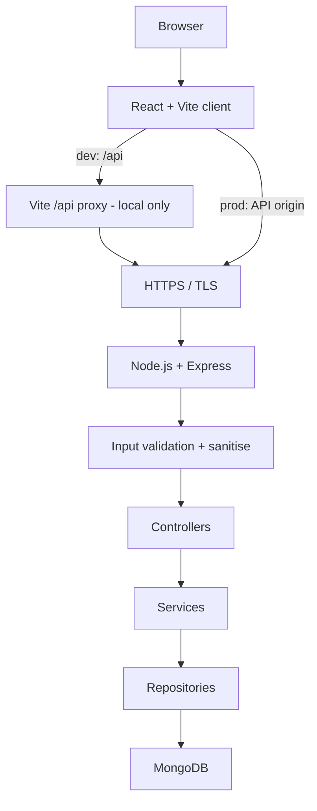
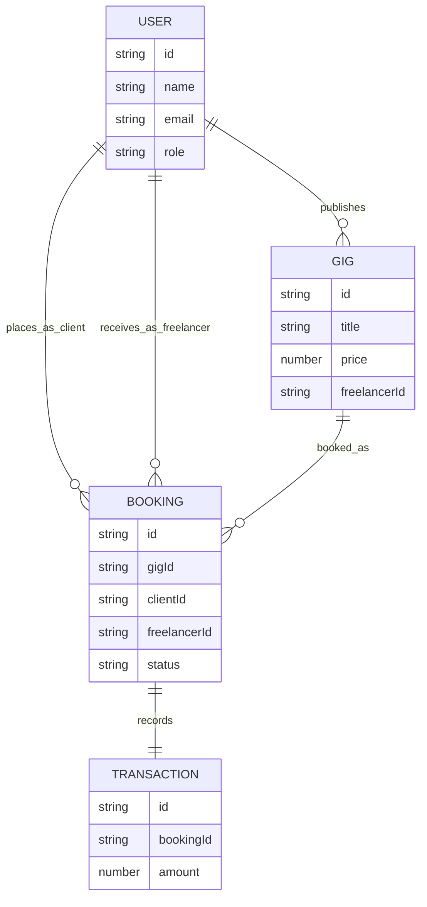
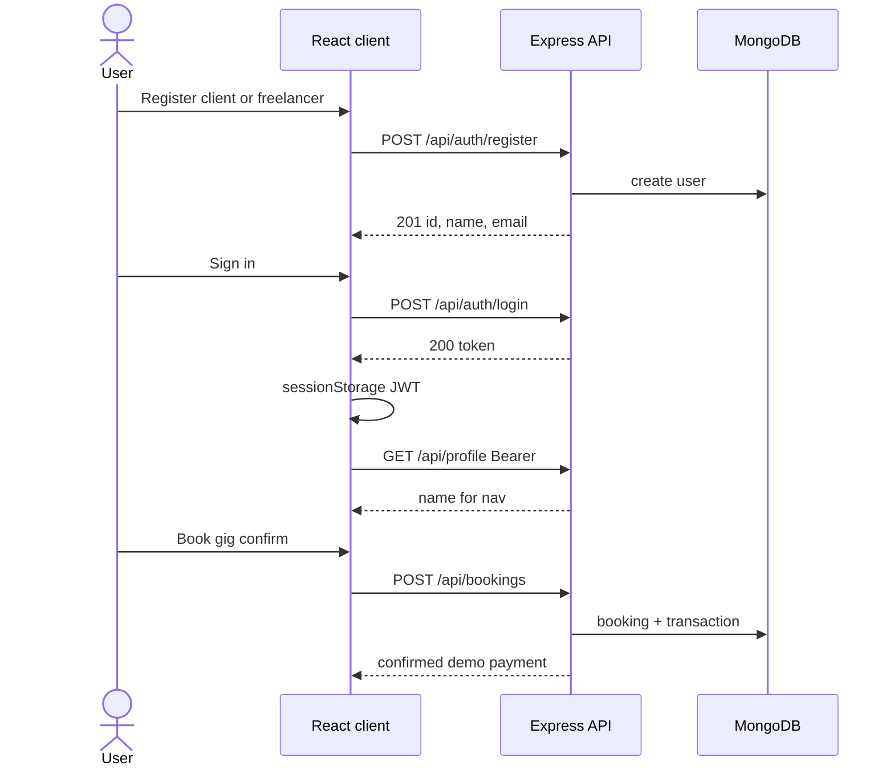
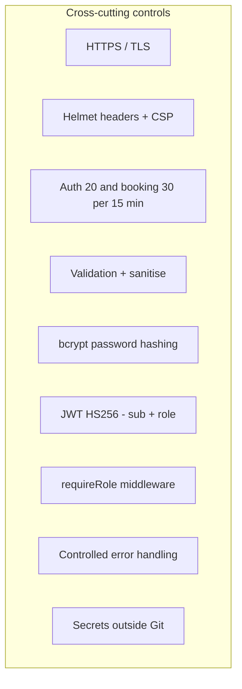

# HustleHub+

HustleHub+ is a secure freelance marketplace (MERN). This README is the project documentation. Do not add extra markdown files for setup or architecture notes.

## System overview

Freelancers publish gigs; clients browse and book them. Bookings create a simulated payment transaction. Freelancers see income on a dashboard. An admin account (development seed only) has read-only oversight of users, gigs, bookings, and transactions.

The API runs on Node.js and Express over HTTPS (Express, 2026; Node.js, 2026). Passwords are bcrypt hashes (bcrypt, n.d.). Authenticated routes use a JWT with `{ sub, role }` (Jones, Bradley and Sakimura, 2015). Data is stored in MongoDB via Mongoose. The React client (Vite) talks to the API through a local `/api` proxy in development.

## Features

- Register as **client** or **freelancer** (public registration cannot create `admin`)
- Sign in with JWT stored in `sessionStorage` for the browser tab
- Public gig catalog with search, sort, and excerpts
- Freelancer: create / edit / delete own gigs; dashboard income and incoming bookings
- Client: book a gig (demo checkout — no card charged); view My bookings
- Admin (seeded): read-only Users, Gigs, Bookings, Transactions screens
- Profile name in the nav after sign-in (`GET /api/profile`)
- Loading, Retry, empty-state next steps, skip link, document titles, focus rings

## Intended users

| Role | What they do |
|---|---|
| Client | Browse and book gigs; see My bookings |
| Freelancer | Publish and manage gigs; see dashboard income and bookings |
| Admin | Read-only oversight (no create/edit/delete in the UI or admin HTTP API) |

## Technology

| Piece | Role |
|---|---|
| Node.js + Express | HTTPS API (Express, 2026; Node.js, 2026) |
| MongoDB + Mongoose | Persistence (`MONGODB_URI`) |
| React + Vite + React Router | Frontend SPA |
| bcrypt | Password hashing (bcrypt, n.d.) |
| jsonwebtoken | JWT HS256 sign/verify (Jones, Bradley and Sakimura, 2015) |
| Helmet | Security headers and CSP |
| express-rate-limit | Auth and booking rate limiting |
| dotenv | Environment config (dotenv, n.d.) |
| Jest + SuperTest | Backend tests (`mongodb-memory-server`) |
| Vitest + Testing Library | Frontend tests |
| Newman | CLI runner for the Postman collection |

## Repository layout

```
src/app.js                 Express app (no listen, no TLS, no DB connect)
src/server.js              HTTPS listener; connects MongoDB; requires JWT_SECRET and certs
src/config/db.js           Mongoose connection helper
src/models/                User, Gig, Booking, Transaction
src/routes/                auth, profile, gigs, bookings, income, admin
src/controllers/           HTTP in/out
src/services/              business rules, public shapes
src/repositories/          MongoDB access (`_id` → public `id`)
src/middleware/            JWT auth, requireRole, Helmet, rate limit, errors
src/scripts/seedAdmin.js   development-only admin seed
client/                    React + Vite SPA
postman/                   Postman collection
tests/                     Jest + SuperTest
evidence/                  Newman JSON report output
.env.example               placeholder variable names, not live secrets
certs/                     local TLS files (gitignored)
```

Request path: route → controller → service → repository. Tests import `app.js`. TLS and MongoDB connect only in `server.js`.

## Architecture

Solid arrows are current Part 2 behaviour.



### Domain relationships



### Auth and booking flow



### Security controls



## Security decisions

- **bcrypt** — plaintext passwords are never stored or returned. Cost factor **10** (bcrypt, n.d.).
- **Password policy** — 8–128 characters with uppercase, lowercase, a digit, and a special character.
- **JWT** — payload is `{ sub, role }`. Secret from `JWT_SECRET` only. Expiry from `JWT_EXPIRES_IN` (default `1h`). HS256 only (Jones, Bradley and Sakimura, 2015).
- **Roles** — `client | freelancer | admin`. Public register accepts only `client` and `freelancer`. Admin is created via `npm run seed:admin` when `NODE_ENV=development`.
- **RBAC** — `authenticate` then `requireRole(...)` on protected gig writes, bookings, income, and all `/api/admin/*` routes.
- **Admin HTTP** — GET only for users, gigs, bookings, transactions. No create/update/delete.
- **Login failures** — unknown email and wrong password both return 401 `Invalid email or password.`
- **Helmet** — security headers and Content-Security-Policy before routes.
- **Rate limiting** — auth routes (register and login share one bucket): **20** requests per 15 minutes per IP. Booking routes (create and list): **30** requests per 15 minutes per IP. Over the limit the API returns **429** `{ error: "Too many requests, please try again later." }`.
- **HTTPS** — `https.createServer` only. Missing certs or `JWT_SECRET` stops the process (Node.js, 2026; OWASP, n.d.).
- **Frontend token** — JWT in `sessionStorage` (cleared when the tab closes). Expired API sessions redirect to Sign in with `reason=expired`.
- **Secrets** — `.env`, `certs/`, and local data artefacts stay gitignored (Git, 2026; OWASP, 2021).

| Control | Where |
|---|---|
| HTTPS / TLS | `server.js` |
| Helmet / CSP | `middleware/securityHeaders.js` |
| Auth rate limit | auth routes, 20 / 15 min |
| Booking rate limit | booking routes, 30 / 15 min |
| Validation | `src/utils/validation.js` |
| bcrypt | user service |
| JWT + role | token service + `authenticate` |
| RBAC | `requireRole` |
| Admin read-only | `routes/adminRoutes.js` |
| Controlled errors | `middleware/errorHandler.js` |

## Installation

### Requirements

- Node.js (API uses CommonJS; client uses ES modules)
- npm
- MongoDB reachable at `MONGODB_URI`
- OpenSSL or [mkcert](https://github.com/FiloSottile/mkcert) for local TLS (OpenSSL, 2026; Valsorda, n.d.)

### Setup

```powershell
git clone https://github.com/akzz98/HustleHub.git
cd HustleHub
npm install
npm install --prefix client
copy .env.example .env
```

Edit `.env`. Set a long random `JWT_SECRET` and a strong `ADMIN_SEED_PASSWORD` if you will seed an admin. Example keys:

```
PORT=3000
NODE_ENV=development
JWT_SECRET=put-a-long-random-value-here
JWT_EXPIRES_IN=1h
MONGODB_URI=mongodb://127.0.0.1:27017/hustlehub
SSL_KEY_PATH=certs/localhost-key.pem
SSL_CERT_PATH=certs/localhost.pem
ADMIN_SEED_NAME=Local Admin
ADMIN_SEED_EMAIL=admin@example.com
ADMIN_SEED_PASSWORD=put-a-strong-password-here
```

Do not commit `.env`.

### Local SSL certificate

```powershell
mkdir certs
```

**mkcert (Windows):**

```powershell
mkcert -install
mkcert -key-file certs/localhost-key.pem -cert-file certs/localhost.pem localhost 127.0.0.1
```

**OpenSSL:**

```powershell
openssl req -x509 -newkey rsa:2048 -sha256 -nodes -keyout certs/localhost-key.pem -out certs/localhost.pem -days 365 -subj "/CN=localhost"
```

Self-signed certs need `curl.exe -k` unless trusted locally (OpenSSL, 2026).

### Start the API

```powershell
npm start
```

Log should show `https://localhost:3000` (or your `PORT`). MongoDB must be running.

### Seed an admin (development only)

```powershell
npm run seed:admin
```

Fails outside `NODE_ENV=development`. Will not elevate an existing non-admin email.

### Start the React client

```powershell
npm run client:dev
```

Opens Vite on `http://localhost:5173`. Browser calls go to `/api/...` and are proxied to `https://localhost:3000` (`VITE_API_PROXY_TARGET` overrides the target). Keep the API running in another terminal.

```powershell
npm run client:build
npm run client:preview
```

## API endpoints

Base URL: `https://localhost:3000`. Examples use `curl.exe -k`.

### Health

`GET /` → **200** `{"status":"ok"}`

### Auth

| Method | Path | Notes |
|---|---|---|
| POST | `/api/auth/register` | Body: `name`, `email`, `password`, `role` (`client` \| `freelancer`). **201** `{ id, name, email }` |
| POST | `/api/auth/login` | Body: `email`, `password`. **200** `{ token }` |

### Profile

| Method | Path | Auth |
|---|---|---|
| GET | `/api/profile` | Bearer JWT → `{ id, name, email }` |

### Gigs

| Method | Path | Auth |
|---|---|---|
| GET | `/api/gigs` | Public list |
| GET | `/api/gigs/:id` | Public detail |
| POST | `/api/gigs` | Freelancer — create |
| PUT | `/api/gigs/:id` | Freelancer — own gig only |
| DELETE | `/api/gigs/:id` | Freelancer — own gig only |

### Bookings and income

| Method | Path | Auth |
|---|---|---|
| POST | `/api/bookings` | Client — body `{ gigId }`; creates booking + simulated transaction |
| GET | `/api/bookings` | Client: own bookings; freelancer: bookings on own gigs |
| GET | `/api/income/me` | Freelancer — `{ totalIncome, transactionCount }` |

### Admin (read-only)

All require Bearer JWT with `role: admin`.

| Method | Path |
|---|---|
| GET | `/api/admin/users`, `/api/admin/users/:id` |
| GET | `/api/admin/gigs`, `/api/admin/gigs/:id` |
| GET | `/api/admin/bookings`, `/api/admin/bookings/:id` |
| GET | `/api/admin/transactions`, `/api/admin/transactions/:id` |

A Postman collection lives at `postman/HustleHub.postman_collection.json`. Import it, disable SSL verification for the local cert, and set `baseUrl` if needed.

## Testing

### Backend — Jest + SuperTest

Tests import `app.js` and use `mongodb-memory-server`. They do not start HTTPS (`server.js`).

```powershell
npm test
```

Covers auth, roles, gigs, bookings, income, admin read-only access, validation, and security-related responses.

### Frontend — Vitest + Testing Library

```powershell
npm run client:test
```

Covers auth pages, browse, booking confirm flow, manage gigs, nav, home variants, and admin list/detail smoke tests.

### Postman / Newman

```powershell
npm run seed:admin
# Sign in as the seeded admin, then pass the token. Do not commit it.
npm run test:newman -- --env-var "adminToken=PASTE_ADMIN_JWT"
```

Runs the collection with `-k` (self-signed TLS) and writes `evidence/newman-report.json`. Requires a running API and `MONGODB_URI` available to that process. Without `adminToken`, the admin success requests are skipped. The client-forbidden admin check still runs.

### HTTPS manual check

1. Certs in `certs/`, secrets in `.env`.
2. `npm start`
3. `curl.exe -k https://localhost:3000/` → **200** `{"status":"ok"}`
4. Confirm missing certs do not fall back to HTTP (process exits).

## Out of scope for Part 2

Tax estimation, CI/CD, Docker, monitoring dashboards, OAuth, refresh tokens, email verification, password reset, and admin create/update/delete of marketplace data.

## References

bcrypt (n.d.) *bcrypt*. Available at: https://www.npmjs.com/package/bcrypt (Accessed: 7 September 2026).

dotenv (n.d.) *dotenv*. Available at: https://www.npmjs.com/package/dotenv (Accessed: 7 September 2026).

Express (2026) *Express 5.x API*. Available at: https://expressjs.com/en/5x/api.html (Accessed: 7 September 2026).

Git (2026) *gitignore*. Available at: https://git-scm.com/docs/gitignore (Accessed: 7 September 2026).

Jest (2026) *Configuring Jest*. Available at: https://jestjs.io/docs/configuration (Accessed: 7 September 2026).

Jones, M., Bradley, J. and Sakimura, N. (2015) *JSON Web Token (JWT)*. RFC 7519. Available at: https://www.rfc-editor.org/rfc/rfc7519.html (Accessed: 7 September 2026).

Node.js (2026) *HTTPS*. Available at: https://nodejs.org/docs/latest/api/https.html (Accessed: 7 September 2026).

OpenSSL (2026) *openssl-req*. Available at: https://docs.openssl.org/master/man1/openssl-req/ (Accessed: 7 September 2026).

OWASP (n.d.) *Transport layer security cheat sheet*. Available at: https://cheatsheetseries.owasp.org/cheatsheets/Transport_Layer_Security_Cheat_Sheet.html (Accessed: 7 September 2026).

OWASP (2021) *Secrets management cheat sheet*. Available at: https://cheatsheetseries.owasp.org/cheatsheets/Secrets_Management_Cheat_Sheet.html (Accessed: 7 September 2026).

SuperTest (n.d.) *supertest*. Available at: https://www.npmjs.com/package/supertest (Accessed: 7 September 2026).

Valsorda, F. (n.d.) *mkcert*. Available at: https://github.com/FiloSottile/mkcert (Accessed: 7 September 2026).
